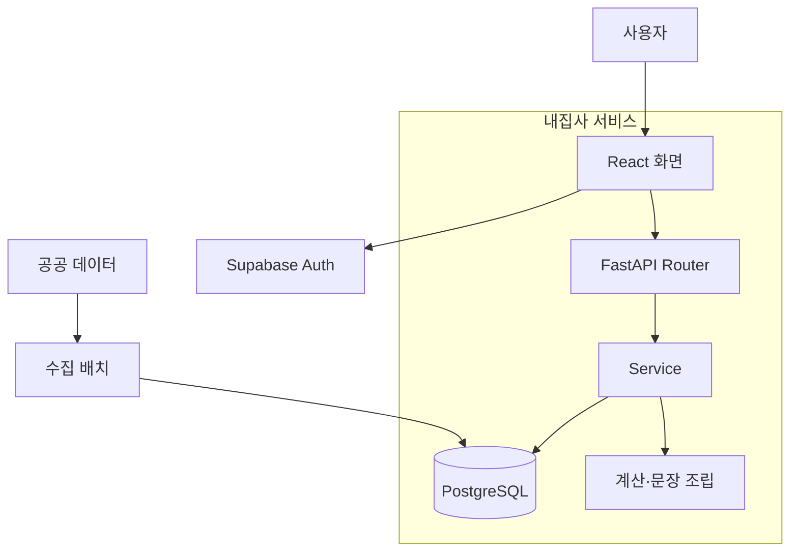
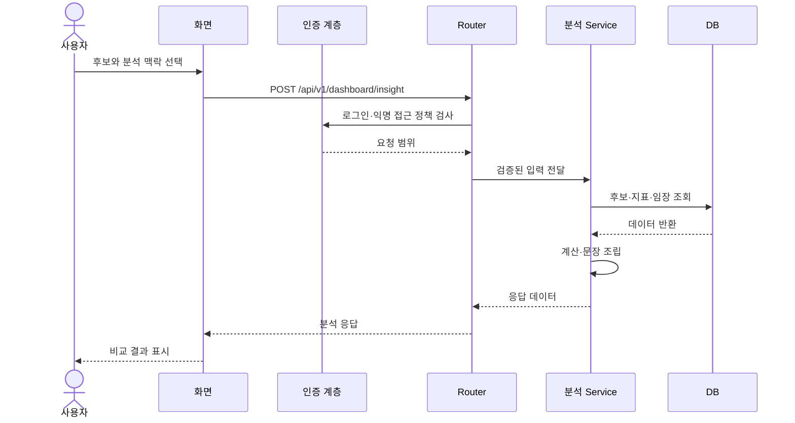

# 구조와 시퀀스 다이어그램

## 시스템 경계

## 후보 분석 순서

익명 분석은 요청에 포함한 후보 등 별도 경로를 사용합니다. 이 그림은 대표 흐름을 요약하며 모든 분기·예외를 열거하지 않습니다.

---
[문서 홈](README.md) · [프로젝트 산출물](프로젝트-산출물.md) · [전체 문서 목록](전체-문서-목록.md)

2026-11-05 기준 제출용 설명 자료 · 서비스 개발 규칙·실행 코드에서 참조하지 않음
