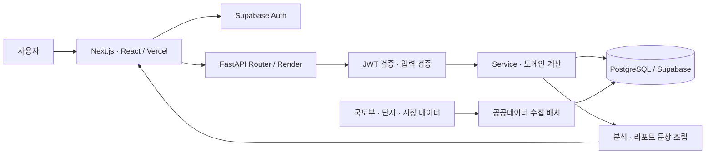
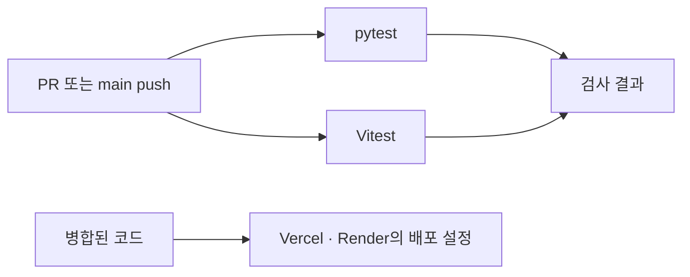

# 서비스 기획 및 아키텍처 설계서

## ① 프로젝트 개요

**주제:** 데이터 기반 의사결정 서비스 개발 템플릿과 내집사 적용 사례.

새 서비스를 시작할 때 인증, API 오류 처리, 데이터 저장, 화면 연결, 테스트 환경, 배포 설정을 반복해서 구성해야 합니다. 내집사의 구현 구조를 정리해 개발자가 저장소를 Fork한 뒤 공통 구조를 참고하고 도메인 로직을 교체할 수 있게 합니다.

**대상 사용자:** FastAPI와 React 기반 서비스를 시작하는 개발자. **적용 서비스:** 실거래·관심 매물·임장 기록·자금 조건을 한 흐름에서 비교하는 내집사.

| 계층 | 사용 기술 | 역할 |
|---|---|---|
| 화면 | Next.js 16, React 19, Recharts | 화면 구성·상태·차트 |
| API | Python 3.14, FastAPI, Pydantic | 요청 검증·서비스 호출·응답 |
| 저장 | PostgreSQL/Supabase, SQLAlchemy, Alembic | 인증 기반 사용자 데이터·마이그레이션 |
| 검증 | pytest, Vitest, GitHub Actions | 백엔드·화면 테스트 |
| 배포 | Vercel, Render | 프론트엔드·백엔드 배포 |

**모델 연동 범위:** 과거 Gemini 기반 분석을 사용했으나, 기준 코드에서는 무료 분석과 상세 리포트가 코드 기반 계산·문장 조립으로 전환되었습니다. 현재 실행 경로에 LangChain 또는 LLM 호출이 포함된다고 가정하지 않습니다. 생성형 모델을 붙이는 확장 위치는 [재사용 가이드](재사용-가이드.md)에 정리했습니다.

## ② 전체 아키텍처



수집은 외부 자료를 저장하는 작업이고, 사용자 분석은 저장된 자료와 사용자 입력을 읽는 작업입니다. 화면은 계산 책임을 서버에 두되 표시 단위 변환 등 화면 전용 처리를 담당합니다.

## ③ 디렉터리 구조와 재사용 경계

```text
myzipsa/
├── backend/app/core/           설정·인증·DB·오류 처리
├── backend/app/dashboard/      후보 매물·대시보드
├── backend/app/group/          그룹·공유
├── backend/app/inspection/     임장 기록
├── backend/app/property/       실거래·단지·지표
├── backend/app/insight/        무료 분석·비교 문장
├── backend/app/loan/           자금·비용 계산
├── backend/app/report/         상세 리포트·저장
├── backend/ingest/             수집 배치
├── backend/alembic/            마이그레이션
├── frontend/components/        화면 컴포넌트
├── frontend/lib/               API·표시 변환
└── .github/workflows/          테스트·수집 자동화
```

`core`의 인증·설정·오류 처리 패턴, 기능별 `router/service/schema/model` 분리, 화면 API 계층, 테스트 격리 방식은 공통 기반으로 참고합니다. 부동산 지표·임장 점수·대출 규칙·문장·데이터 소스는 새 서비스에 맞게 교체해야 합니다. 기존 DB를 새 서비스와 공유하지 않습니다.

## ④ 사용자 요청 흐름

1. 사용자가 Supabase Auth로 로그인합니다.
2. 화면 API 모듈이 세션 토큰을 Authorization 헤더에 담습니다.
3. FastAPI의 인증·의존성 계층이 토큰과 사용자 범위를 확인합니다.
4. Router가 입력을 검증하고 Service에 처리를 위임합니다.
5. Service가 후보·실거래·임장·사용자 조건을 조회하고 계산합니다.
6. 무료 분석은 비교 문장을, 상세 리포트는 계산 결과·가정·출처를 묶습니다.
7. 응답 스키마에 맞춰 반환하면 화면이 카드와 표를 표시합니다.

## ⑤ CI/CD 파이프라인 설계

| 단계 | 기준 코드에서 확인한 구성 | 실패·주의 사항 |
|---|---|---|
| 트리거 | PR, main push | 이전 실행 취소 설정 포함 |
| 백엔드 검사 | Python 3.14 의존성 설치 후 pytest | 실패하면 해당 작업 실패 |
| 프론트 검사 | Node 24, npm ci, Vitest 재시도 1회 | 실패하면 해당 작업 실패 |
| 빌드 | 제공 CI 파일에는 별도 build 작업 없음 | 로컬 또는 배포 플랫폼 빌드와 구분 |
| 배포 | Vercel·Render 설정으로 운영 | GitHub CI와 자동 배포 게이트 연결 여부 별도 확인 |



테스트 성공 여부를 필수 병합 조건으로 지정했는지, 배포 플랫폼이 검사 완료를 기다리는지는 저장소·플랫폼 설정 확인이 필요합니다. CI 파일만으로 테스트 실패 시 모든 배포가 차단된다고 결론 내리지 않습니다.

## ⑥ 주요 설계 결정

- 기능별 Router·Service·Schema·Model로 요청과 계산·저장 책임을 분리합니다.
- 인증은 Supabase Auth, DB 접근은 SQLAlchemy로 나눕니다.
- 가격·자금 계산과 문장 표현을 분리해 숫자 근거를 추적합니다.
- 테스트는 메모리 DB와 테스트 토큰을 사용해 운영 환경과 분리합니다.
- 환경변수 예시는 버전 관리하고 실제 비밀 값은 배포 환경에서 관리합니다.
- 제출 자료는 별도 문서 저장소에 보관해 개발 지침·실행 코드에 연결하지 않습니다.

## 근거

- 구현 근거 파일: `README.md` (원본 저장소 내부 경로)
- 구현 근거 파일: `frontend/package.json` (원본 저장소 내부 경로)
- 구현 근거 파일: `backend/app/insight/service.py` (원본 저장소 내부 경로)
- 구현 근거 파일: `backend/app/core/config.py` (원본 저장소 내부 경로)
- 구현 근거 파일: `.github/workflows/ci.yml` (원본 저장소 내부 경로)
- 구현 근거 파일: `docs/architecture/paid-report-flow.md` (원본 저장소 내부 경로)

---
[문서 홈](README.md) · [프로젝트 산출물](프로젝트-산출물.md) · [전체 문서 목록](전체-문서-목록.md)

2026-11-05 기준 제출용 설명 자료 · 서비스 개발 규칙·실행 코드에서 참조하지 않음
